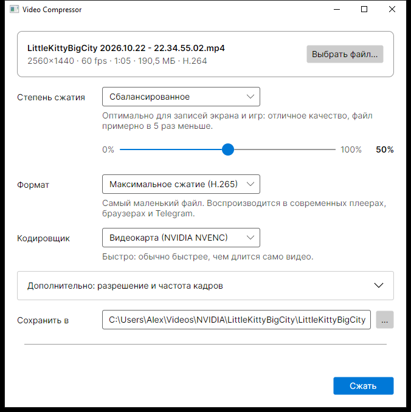

# Video Compressor

[](https://github.com/StenlyForse/VideoCompressor/actions/workflows/ci.yml)

Локальная кросс-платформенная утилита для сжатия видео без заметной потери качества. Задумана для тяжёлых записей экрана, например из NVIDIA App (~200 МБ на минуту), как замена онлайн-сервисам сжатия.



- **Полностью локально:** файлы никуда не загружаются.
- **Четыре уровня сжатия и ползунок в процентах** для точной настройки.
- **Быстрое кодирование на видеокарте NVIDIA (NVENC)** или чуть более компактное на процессоре.
- **По желанию:** уменьшение разрешения и частоты кадров.
- **Исходный файл не изменяется.** Результат сохраняется рядом как `<имя>_compressed.mp4` и никогда не перезаписывает существующие файлы молча.

> **Статус v1 (MVP):** проверено и откалибровано на Windows с видеокартой NVIDIA. На macOS и Linux ядро (FFmpeg, анализ, сжатие на процессоре, отмена) проверяется автоматическими тестами в CI, а окно приложения там ещё не проверялось вживую.

## Чего ожидать

Замеры на реальной записи из NVIDIA App: игра, 2560×1440, ~60 fps, 65 секунд, **190,5 МБ**. Кодирование на видеокарте RTX 3060 Ti, исходные разрешение и частота кадров:

| Уровень | % | Размер | Качество |
|---------|---|--------|----------|
| Минимальное | 25 | ~80 МБ | Практически неотличимо от исходника |
| **Сбалансированное** (по умолчанию) | 50 | **38,5 МБ** (−80%) | Отличное |
| Сильное | 75 | ~20 МБ | Небольшие потери в мелких деталях |
| Максимальное | 100 | ~11 МБ | Потери заметны |

Размеры даны для H.265. В формате H.264 (выбирается автоматически, если система не умеет показывать H.265) «Сбалансированное» даёт 64,5 МБ (−66%) за 24 с.

Время на видеокарте около 43 с — быстрее, чем длится само видео. На процессоре файл на 10–20% меньше при том же качестве, но сжатие примерно в 2 раза дольше.

Записи рабочего стола обычно сжимаются сильнее игр, а уже сжатое видео — слабее. Если результат не меньше исходника, приложение предложит его удалить.

Как подбирались параметры, описано в [research.md](specs/001-video-compressor/research.md).

## Требования

- [.NET 10 SDK](https://dotnet.microsoft.com/download/dotnet/10.0)
- [FFmpeg](https://ffmpeg.org/) 6 или новее, вместе с `ffprobe`. В репозиторий FFmpeg не входит, его нужно установить отдельно.
- Для кодирования на видеокарте: NVIDIA GeForce RTX 20xx или новее (а также большинство GTX 16xx) и актуальный драйвер. Нужна поддержка B-кадров в HEVC — приложение проверяет это пробным кодированием при запуске и на неподходящих видеокартах само переключается на процессор.

### Установка FFmpeg

| ОС | Команда |
|----|---------|
| Windows | `winget install Gyan.FFmpeg` |
| macOS   | `brew install ffmpeg` |
| Linux (Debian/Ubuntu) | `sudo apt install ffmpeg` |

Приложение ищет `ffmpeg` и `ffprobe` в таком порядке:
1. рядом со своим исполняемым файлом;
2. в подпапке `ffmpeg/`;
3. в `PATH`;
4. в стандартных папках установки: WinGet на Windows, Homebrew на macOS, `/usr/bin` и `/snap/bin` на Linux.

Если FFmpeg не найден, приложение покажет, какую команду выполнить.

## Сборка и запуск

```sh
dotnet run --project src/VideoCompressor.App
```

Сборка под конкретную ОС (нужен установленный .NET 10 Runtime на целевой машине):

```sh
dotnet publish src/VideoCompressor.App -c Release -r win-x64     # или osx-arm64, osx-x64, linux-x64
```

Тесты (интеграционные тесты пропускаются, если FFmpeg не найден):

```sh
dotnet test
```

## Как пользоваться

1. Перетащите одно или несколько видео в окно или нажмите «Добавить файлы…» (в диалоге можно выбрать сразу несколько).
2. Выберите степень сжатия. «Сбалансированное» подходит в большинстве случаев. Настройки применяются ко всем файлам в списке.
3. Нажмите «Сжать». Файлы сжимаются по очереди; у каждого видно состояние, внизу — общий прогресс. Кнопка «Показать файл» у готового файла откроет папку с результатом.

Результаты сохраняются рядом с исходниками как `<имя>_compressed.mp4`. Если файл один, путь можно поменять в поле «Сохранить в». Ошибка в одном файле не останавливает остальные. «Отмена» останавливает текущий и оставшиеся файлы, а уже готовые сохраняются; повторное «Сжать» продолжит с неготовых.

**Формат выбирается автоматически.** «Максимальное сжатие (H.265)» даёт самый маленький файл, но встроенному плееру Windows для него нужно расширение [«Видео HEVC»](https://apps.microsoft.com/detail/9NMZLZ57R3T7) из Microsoft Store (VLC, браузеры, Telegram и macOS показывают H.265 и без него). Если система не умеет показывать H.265, приложение по умолчанию выбирает «Максимальную совместимость (H.264)»: файл примерно в 1,5–2 раза больше, зато откроется где угодно. Формат можно выбрать и вручную — тогда выбор запоминается.

Разрешение и частота кадров — в блоке «Дополнительно». Выбранные настройки запоминаются между запусками.

## Ограничения

- Файлы в очереди сжимаются по одному, с общими настройками.
- Аппаратное кодирование только на NVIDIA. AMD, Intel и Apple VideoToolbox пока не поддерживаются, на этих системах сжатие идёт на процессоре.
- HDR-видео специально не обрабатывается, цвета могут выглядеть блёклыми.
- На macOS неподписанное приложение может блокироваться Gatekeeper. Удобнее запускать через `dotnet run`.

## Структура

| Путь | Назначение |
|------|------------|
| `src/VideoCompressor.Core` | Ядро: работа с FFmpeg, параметры сжатия. Не зависит от UI |
| `src/VideoCompressor.App` | Оконное приложение на [Avalonia](https://avaloniaui.net/) |
| `tests/VideoCompressor.Core.Tests` | Тесты ядра (xUnit v3): юнит и интеграционные |
| `specs/` | Спецификации: требования, исследование параметров кодирования, план, задачи и журнал выполнения |

Проект ведётся по принципу spec-driven development: подробности — в [specs/001-video-compressor](specs/001-video-compressor/).

## Лицензия

[MIT](LICENSE). Программа предоставляется «как есть», без гарантий.
